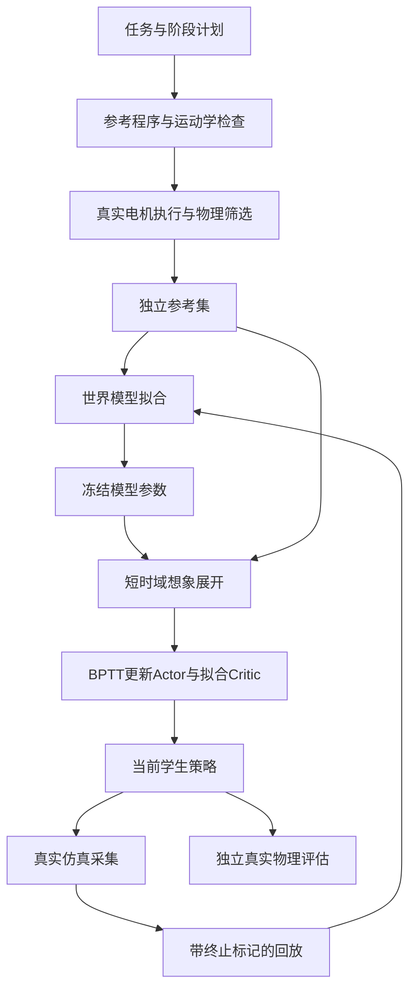

# SuperMimic-Agent-WFArm 项目分析：从可微世界模型到四轮足机械臂控制

[English README](../README.md) · [中文 README](../README_CN.md)

## 一、项目要解决的问题

四轮足机械臂的末端运动由底盘、腿部和机械臂共同决定。底盘平移改变操作位置，腿部改变机身高度和姿态，机械臂完成局部位姿调整。同一个末端目标可能对应不同的全身构型，而接触、关节限位和执行器响应又会限制这些构型是否真正可行。

本项目研究用一个可学习、可微分的动力学模型连接这些环节。物理引擎负责产生真实转移，世界模型拟合转移规律，策略在模型里做短时间展开，通过梯度提高任务回报，再回到真实仿真中检验。参考轨迹为训练提供初始方向，但实际执行和学生策略的表现仍需分别评估。

代码同时保留两种设置：

1. **自由底盘的轮腿臂协同控制**：一个 Actor 联合输出 22 路命令，研究末端任务与底盘、机身调整之间的关系。
2. **固定底盘的六轴机械臂控制**：固定底盘、腿和轮，只保留六个机械臂自由度，用于到达、跟踪及结构化反馈实验。

两者共享世界模型与 BPTT 的学习思路，但状态、动作和可用控制结构不同。固定底盘结果不能直接回答自由底盘是否稳定，全身单策略的实验也不能替代固定底盘控制器的独立验收。

这是一个探索类开源项目。讨论的对象既包括学习算法，也包括参考生成、数据边界、控制接口和评估方法。欢迎围绕这些问题交流。

## 二、技术来源与项目定位

[SuperMimic](https://arxiv.org/abs/2610.28480) 提供了“真实仿真采集—可微世界模型—短时域 BPTT”的主要学习机制。[MimicAgent](https://arxiv.org/abs/2609.24145) 提供了通过程序生成参考、用检查反馈修正参考的思路。本项目将这些机制适配到四轮足机械臂，并保留对应的数据检查和真实物理评估。

项目继承了 [SuperMimic-Reproduced](https://github.com/CuboiLeo/SuperMimic-Reproduced) 的部分基础实现。原有 G1 动作跟踪路径保留了状态处理、可微 FK、想象展开和训练工具；这里不展开其动作库基准，重点放在 WF-Arm 的控制任务。具体改编以本仓库源码为准，不能将原论文的硬件结果、训练效率或数据规模视为本项目的结果。

项目名称中的三个部分各有侧重：SuperMimic 对应学习机制，Agent 对应参考生成与诊断接口，WFArm 对应四轮足机械臂这一对象。当前 Agent 接口通过文件接收编码代理提交的程序，尚未包含常驻的外部模型服务。

## 三、从数据到策略的整体流程

这条流程中有三种不同的数据：

- **运动学提案**：按时间描述期望构型，只能用于规划和检查。
- **实际执行参考**：由真实电机命令驱动仿真得到，保存实际状态、动作、接触和失败信息。
- **学生在线转移**：由当前策略自身产生，包含成功、偏离和失败状态。

世界模型需要学习后两类真实转移。将期望底盘轨迹直接写入状态再当作执行数据，会破坏动力学标签。只保留教师成功样本，则又可能遗漏学生经常访问的失败区域。

## 四、轮腿臂状态与动作

### 4.1 状态维数

全身分支采用 57 维状态：

$$
s_t=\left[p_t,\;r_t,\;q_t,\;v_t,\;\omega_t,\;\dot q_t\right],
$$

其中 $p_t\in\mathbb R^3$ 为世界位置，$r_t\in\mathbb R^4$ 为 wxyz 四元数，$q_t\in\mathbb R^{22}$ 为关节位置，$v_t\in\mathbb R^3$ 为世界线速度，$\omega_t\in\mathbb R^3$ 为机身角速度，$\dot q_t\in\mathbb R^{22}$ 为关节速度。维数之和为 $3+4+22+3+3+22=57$。

状态处理位于 [`wf/model.py`](../src/supermimic/wf/model.py)，仿真读写位于 [`wf/simulator.py`](../src/supermimic/wf/simulator.py)。动力学网络实际接收 53 维规范化特征，去掉全局平移和航向中的冗余信息，并使用非轮关节相对默认位置。轮子的累计相位不进入状态误差，但轮速保留。

这减少了网络为平移、航向和圆柱轮相位重复学习同一种局部动力学的负担。网络依然需要区分机身姿态、接触与关节速度，不能把这类规范化等同于完整的物理不变性保证。

### 4.2 22 维动作的物理含义

动作向量按 12 腿、4 轮、6 臂排列。腿和臂使用位置目标，轮使用速度目标：

$$
q^{\mathrm{target}}_i=q_i^0+\sigma_i a_i,
\qquad
\dot q^{\mathrm{target}}_j=\sigma_j a_j.
$$

动作通常归一化到 $[-1,1]$，但归一化命令不等于实际关节状态。仿真按 PD、力矩限制和真实接触计算运动。实际力矩由位置或速度误差形成，并受执行器能力限制。

统一输出表示一次策略决策覆盖全部 22 路命令。它没有自动证明这些通道形成了有效协同；需要用末端误差、底盘动作、机身姿态与通道干预实验检验。

## 五、世界模型如何学习

### 5.1 残差与显式积分

动力学模型为

$$
\hat s_{t+1}=F_\theta(\hat s_t,a_t,\xi),
$$

$\xi$ 在全身分支中包含摩擦上下文。模型先预测有界速度与位置残差，再执行显式积分。以平移为例：

$$
\hat v_{t+1}=\hat v_t+R_h\Delta v_\theta,
\qquad
\hat p_{t+1}=\hat p_t+\Delta t\hat v_{t+1}+R_h\Delta p_\theta.
$$

$R_h$ 是当前航向旋转。关节位置采用相似的速度积分与残差形式，姿态用旋转向量构造增量四元数并归一化。残差经过 $\tanh$ 和尺度限制，避免初始化时任意大的状态跳变。

固定底盘分支使用更小的状态 $s=[q,\dot q]\in\mathbb R^{12}$，模型输入再加入六维命令。两种状态布局应分别理解。

### 5.2 多步自回归损失

模型训练不是每一步都重新使用真实状态，而是从窗口第一帧开始连续预测：

$$
\hat s_{t+k+1}=F_\theta(\hat s_{t+k},a_{t+k},\xi).
$$

全身分支的损失可写为

$$
\mathcal L_{\mathrm{WM}}=
\frac1K\sum_{k=1}^K\left[
\frac1m\|E(\hat s_{t+k},s_{t+k})\|_2^2
+\beta\operatorname{BCE}(\hat d_{t+k},d_{t+k})
\right].
$$

$E$ 对位置、旋转、关节与速度采用各自尺度，$m$ 为误差维数，$\beta=0.1$。固定底盘实现将关节位置和速度误差分别求平均再相加；其归一化与全身分支不完全相同。

多步拟合能够暴露滚动预测的误差累积，但模型误差小仍不保证动作导数正确。策略优化依赖 $\partial F_\theta/\partial a$；一个对状态预测尚可、对动作变化反应不足的模型，也可能给出无效策略梯度。代码中的动作响应检查因此将真实有限动作扰动与模型响应进行对照。

### 5.3 失败预测与真实接触

全身分支将学习的失败概率与解析失败概率组合：

$$
\hat d=1-(1-\hat d_{\mathrm{learned}})(1-\hat d_{\mathrm{analytic}}).
$$

这限制了想象中不合理状态的延续。实际评估仍读取真实接触和关节越界，不依赖网络判断是否发生物理失败。学习失败头、解析软约束和真实硬判据各自处理不同问题。

## 六、Actor 与 Critic 的优化

### 6.1 短时域策略目标

从回放中抽取起点，在世界模型内执行策略：

$$
a_t=\pi_\phi(o_t,g_t),\qquad
\hat s_{t+1}=F_\theta(\hat s_t,a_t,\xi).
$$

全身实现的目标为

$$
J(\phi)=\mathbb E\left[
\sum_{t=0}^{H-1}\gamma^t C_t r_{t+1}
+\gamma^H C_H V_\psi(\hat s_H,g_H,\xi)
\right],
\quad C_0=1,\quad C_t=\prod_{j=1}^{t}(1-\hat d_j).
$$

这里的 $C_t$ 与 [`imagination/objective.py`](../src/supermimic/imagination/objective.py) 的索引一致。固定底盘训练循环先更新存活概率再计入当前奖励，奖励权重的边界索引有所不同，应以各分支循环为准。

Actor 更新时，将世界模型与 Critic 的参数设为不求梯度，但不切断它们对状态和动作的导数。两种操作不同：冻结参数仍允许梯度穿过网络；对中间状态做 `detach()` 会切断 BPTT。

### 6.2 参考辅助与 BC

有示范时，全身 Actor 损失还包括行为克隆：

$$
\mathcal L_\pi=-\frac{J}{H}
+\lambda_{\mathrm{BC}}(u)\,
\mathbb E_{\mathcal D_{\mathrm{train}}}
\|\pi_\phi(o,g)-a^{\mathrm{ref}}\|^2.
$$

参考状态跟踪可以作为想象奖励的辅助项，权重随更新次数衰减。源码对目标扰动后的参考对齐做了处理：如果目标变了，原轨迹未必仍是正确的状态标签。BC 和真实任务奖励也不应因用了同一个参考库就被当作同一监督来源。

[`wf/train.py`](../src/supermimic/wf/train.py) 还允许将 Actor 使用的参考跟踪辅助从 Critic 目标中移除。这样可以避免 Critic 对部署时不可见的标签形成依赖。

### 6.3 Critic 的 λ-return

Critic 的训练目标停止梯度，按逆序计算：

$$
R_H^\lambda=V_\psi(\hat s_H,g_H,\xi),
$$

$$
R_t^\lambda=r_{t+1}+\gamma(1-\hat d_{t+1})
\left[(1-\lambda)V_\psi(\hat s_{t+1},g_{t+1},\xi)
+\lambda R_{t+1}^\lambda\right].
$$

随后最小化 $\mathcal L_V=\mathbb E(V_\psi-R^\lambda)^2$。短展开、存活加权和价值自举共同控制优化时域，但并不能消除模型偏差，需要真实仿真持续提供新数据。

## 七、任务奖励与可微运动学

任务模块从模型中读取运动学树，使用 Torch 计算正运动学、TCP 位姿和速度。它把学习状态转成控制任务所需的几何量，使末端奖励可以对状态与动作求导。

常见的位姿跟踪项写为

$$
r_{\mathrm{pose}}=w_p\exp\left(-\frac{\|p-p^*\|^2}{\sigma_p^2}\right)
+w_R\exp\left(-\frac{\|e_R\|^2}{\sigma_R^2}\right).
$$

其中 $e_R$ 由四元数或旋转误差构造。完整奖励还包括末端速度、关节限位、动作变化、功率、机身姿态、支撑与几何间隙等项。具体启用哪些项由配置决定。

采样表面间隙和接触代理为学习提供平滑信号，真实碰撞仍由 MuJoCo 负责。把平滑代理当作精确网格碰撞会高估模型的约束能力。相关实现分别在 [`wf/task.py`](../src/supermimic/wf/task.py) 和 [`wf/geometry_clearance.py`](../src/supermimic/wf/geometry_clearance.py)。

## 八、固定底盘机械臂与结构化反馈

### 8.1 固定底盘不是屏蔽动作

固定底盘模型从私有整机模型的内存副本构造，底盘、腿、轮和夹爪固定，仅保留六个机械臂物理自由度。模型检查要求 $n_q=n_v=n_u=6$。因此底盘不会在仿真里自由响应后再靠“零动作”假装固定。

对外目标使用底盘 base 坐标系中的 TCP 位置、wxyz 四元数，以及可选线速度和角速度。外部输出始终是六个绝对关节位置目标：

$$
q^{\mathrm{cmd}}_{t+1}
=\operatorname{clip}_{[q_{\min},q_{\max}]}
\left(q^{\mathrm{cmd}}_t+\Delta t\,v_{\max}\rho_t\right).
$$

下游若进一步限制指令，应将实际执行目标反馈给控制器，避免内部记录与真实命令历史不一致。

### 8.2 结构化策略如何使用学习结果

结构化分支将学习集中在有界正反馈增益上：

$$
k_\phi=1+\alpha\tanh f_\phi(o,z,\rho_{\mathrm{source}}),
\qquad 0<\alpha<1.
$$

典型配置取 $\alpha=0.3$，增益落在 $[0.7,1.3]$。保留的源策略提供姿态运动；大幅到达时，规划器还可提供关节参考与速度。

令 $J$ 为 TCP 雅可比，$W$ 为任务分量权重，则阻尼广义逆为

$$
J_\lambda^\#=(J^T W^2J+\lambda^2I)^{-1}J^T W^2.
$$

控制方向可概括为

$$
v_{\mathrm{task}}=\dot x^*+2k_\phi\odot(e_x+e_{\dot x}),
$$

$$
\dot q=J_\lambda^\#v_{\mathrm{task}}
+(I-J_\lambda^\#J)\dot q_{\mathrm{nominal}}.
$$

实现还限制线性和角向修正、对关节速度做整体缩放，并按误差门控混合姿态运动。由于使用了阻尼，$I-J_\lambda^\#J$ 是近似剩余方向算子，不能当作精确零空间投影。

学习得到的增益、解析几何方向、姿态策略和路径参考共同构成控制器。这一结构应在算法介绍中直接说明，而不只保留“神经网络输出动作”的简化表述。

### 8.3 路径参考的职责

规划器通过目标位姿寻找候选关节构型，并检查路径上的碰撞。它生成的是内部参考，真正执行指令由低层控制过程产生。规划模型和真实评估模型分别维护，规划间隙不能改写评估物理。

结构化分支保留前序策略与目标编码器，复现训练需要对应的本地训练阶段或检查点。开源代码包含其结构，私有权重不会随源码上传。

## 九、MimicAgent × SuperMimic：参考生成与策略学习的联动

参考前端位于 [`mimicagent/pipeline.py`](../src/supermimic/mimicagent/pipeline.py)。每次运行保存任务、阶段计划、代码、程序哈希、执行输出和检查反馈。它最多处理三版程序，并把前次反馈加入下一次请求。

运动学检查覆盖形状和数值、初始姿态、四元数、机身高度、关节范围与速度、轮地穿透、支撑时间和碰撞。通过后还可选择双摩擦条件下的真实电机执行。物理执行不会将提案的期望浮动基座位置写入仿真状态。

请求目标在物理执行前由提案几何确定，执行后不改成实际达到的位置。这个边界避免通过事后重标目标得到虚假的成功。

当前可选的末段反馈来自已有离线教师，是 WF-Arm 的工程适配。它帮助将运动学提案转成可执行参考，但也引入了教师能力这一条件。比较参考生成方案时，应使用相同的执行与筛选过程，分别报告提案可行率和学生收益。

因此，MimicAgent 在本项目中的角色是离线参考提案前端。它既不替代底层物理，也不等同于已经训练好的控制策略。语义是否符合任务还需要检查；通用结构检查不负责判断动作是否完整实现自然语言意图。

## 十、数据划分与评估边界

回放保存真实下一状态、失败和超时，窗口采样不跨越 reset。失败转移可以作为世界模型标签，reset 后的初始帧不能接在失败前动作后面当作普通动力学转移。

参考数据按完整请求或完整轨迹划分训练与验证，避免相邻帧同时出现在两侧。最终测试请求还应单独封存，在模型拟合、BC、Actor 更新和候选选择中都不使用。

到达任务要求末尾连续满足位置、姿态和速度误差。跟踪任务计算请求轨迹中达标帧比例；失败后的未执行请求帧仍计入分母。结果应至少分别报告：

| 指标 | 回答的问题 |
|---|---|
| 世界模型滚动误差 | 状态预测是否准确 |
| 动作响应误差或方向一致性 | 控制导数是否有用 |
| 教师轨迹可行率 | 参考能否被物理执行 |
| 学生到达或跟踪成功率 | 策略是否完成请求 |
| 物理失败率 | 是否发生碰撞、失稳或越界 |
| 末端误差与底盘运动误差 | 精度与移动要求是否同时满足 |
| 真实交互量与训练时间 | 达到相同能力的代价 |

全身行进操作尤其需要同时检查底盘速度和末端任务。静态到达、停车后的到达、连续行进中的操作应分开统计。固定底盘六轴任务和保留的 G1 跟踪也不应进入同一个成功率分母。

## 十一、运行与依赖

完整命令见[中文 README](../README_CN.md#运行步骤)。推荐顺序是安装基础依赖、运行无资产测试、接入私有资产、检查全身训练、检查固定底盘基线，再进行参考生成和学习对照。

基础依赖是 PyTorch、MuJoCo、NumPy 和 SciPy。pytest 用于测试；OSQP 与 quadprog 仅服务于可选离线 QP 教师；媒体和 G1 依赖分开放入额外安装组。WF 后端的 CUDA 选项加速学习，不能据此声称物理采集已经迁移到 GPU。

示例配置限制了小规模检查的预算，它用于发现接口、数据或数值问题，不用于发布任务成功率。较大实验应重新设定数据规模、训练预算和独立评估协议。

## 十二、源码发布与私有资产的分离

本次 GitHub 版本只分发精选源码、算法测试、无敏感参数的示例和最终文档。机器人 URDF、网格、CAD、标定、工作限位、训练数据、检查点、TorchScript、视频和内部实验记录保留在本地。

排除模型权重也有技术原因：一些导出模块会携带运动学树、连杆变换或几何采样缓存。只排除 URDF，而上传带这些缓存的导出模型，仍可能暴露机器人信息。

源码通过 `WFARM_ASSET_DIR` 或显式 `asset_dir` 访问授权资产，配置文件契约见[私有资产说明](PRIVATE_ASSETS.md)。发布目录由白名单构建，并检查符号链接、文件后缀、凭据模式、个人绝对路径和 Git 跟踪内容。`.gitignore` 是辅助边界，不替代发布审查。

## 十三、后续值得比较的方向

优先比较三类差异：

1. 在相同真实交互预算下，参考引导能否提高零位启动的学习效率。
2. 结构化反馈能否在更广的位姿、速度和接触条件下保持收益，其收益分别来自规划、几何反馈还是学习增益。
3. 原程序化参考与编码代理生成参考，在相同物理筛选和数据划分下，是否带来可重复的学生策略改善。

这些实验需要控制变量并保存独立测试，不能只比较训练回报。项目开放的是这套可继续检查和修改的实现，欢迎提交复现记录、失败案例和替代设计。

## 参考与致谢

- SuperMimic 原论文：[arXiv:2610.28480](https://arxiv.org/abs/2610.28480)。
- MimicAgent 原论文：[arXiv:2609.24145](https://arxiv.org/abs/2609.24145)。
- 上游独立实现：[CuboiLeo/SuperMimic-Reproduced](https://github.com/CuboiLeo/SuperMimic-Reproduced)。
- 基础工具：[PyTorch](https://pytorch.org/)、[MuJoCo](https://mujoco.org/)、[NumPy](https://numpy.org/)、[SciPy](https://scipy.org/)、[mjlab](https://github.com/mujocolab/mjlab)。

代码使用 [MIT 协议](../LICENSE)，保留上游版权。完整来源说明见 [NOTICE](../NOTICE.md)。
